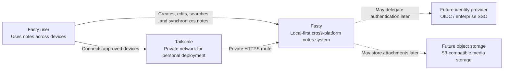
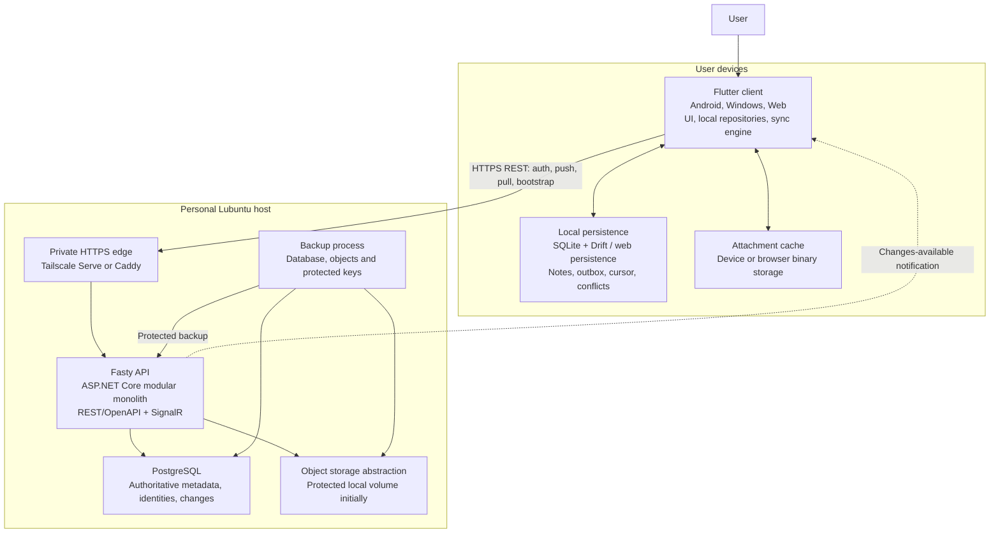
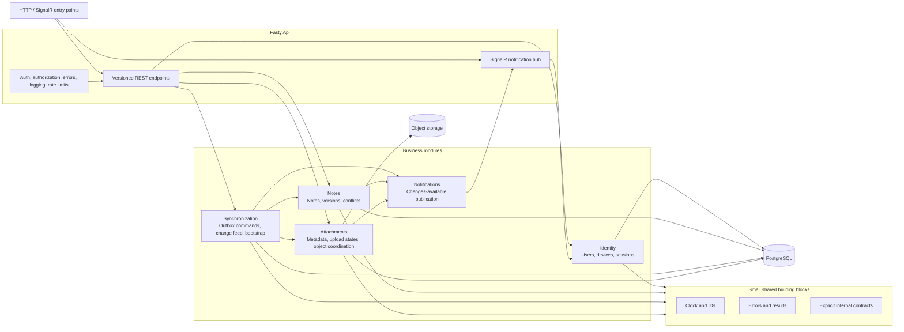
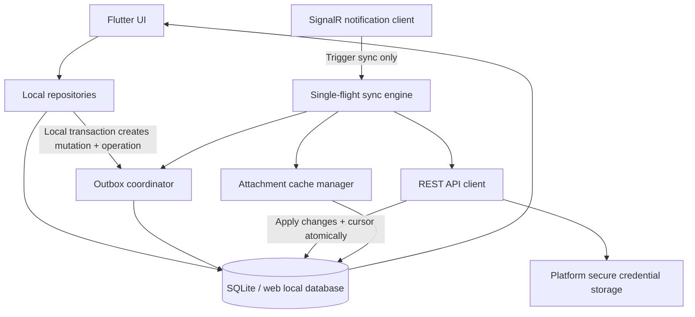
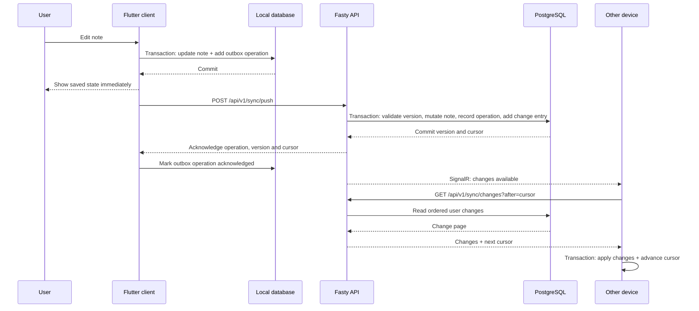
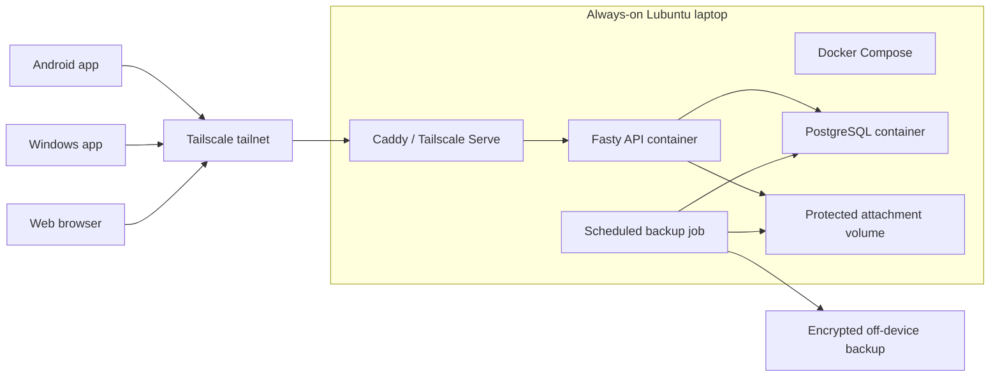

# Fasty — C4 Architecture Diagrams

These diagrams describe the intended architecture before Phase 1 implementation. They must be updated when implementation materially changes the system.

## Level 1 — System context

### Context notes

- The user interacts through Android, Windows, or web clients.
- The system remains useful while disconnected because note text is stored locally.
- Tailscale is a deployment boundary, not the Fasty authentication system.
- External identity and object-storage systems are future integrations, not MVP dependencies.

## Level 2 — Containers

### Container responsibilities

#### Flutter client

- Renders adaptive mobile, desktop, and web interfaces.
- Reads application state from local persistence.
- Writes user mutations locally and to the outbox atomically.
- Pushes pending operations and pulls incremental server changes.
- Stores native credentials in platform-protected storage.
- Uses secure cookies on web.

#### Local persistence

- Stores note text for offline access.
- Stores the outbox, synchronization cursor, conflict copies, and attachment metadata.
- Applies downloaded changes and cursor advancement transactionally.

#### Fasty API

- Authenticates users and authorizes every resource operation.
- Processes idempotent synchronization commands.
- Maintains server versions, tombstones, conflicts, and durable change entries.
- Exposes versioned REST/OpenAPI endpoints.
- Sends optional SignalR change notifications.
- Coordinates attachment metadata with binary storage.

#### PostgreSQL

- Authoritative system of record for identities, notes, synchronization state, conflicts, and attachment metadata.
- Enforces relational constraints and transactional invariants.

#### Object storage abstraction

- Stores media binaries outside PostgreSQL.
- Begins as protected local storage and can move to S3-compatible storage.

#### Backup process

- Produces versioned, protected backups.
- Includes PostgreSQL, object data, configuration required for restoration, and persistent cryptographic keys.
- Is validated through restoration tests.

## Level 3 — ASP.NET Core modular monolith

### Module rules

- Modules expose explicit application contracts.
- No module accesses another module's infrastructure implementation directly.
- Domain code does not depend on ASP.NET Core, EF Core, SignalR, or storage SDKs.
- The API layer contains transport mapping, not domain rules.
- One PostgreSQL database may use module-owned schemas.
- Cross-module transactions are allowed only where required by documented invariants, especially note mutation plus change-feed creation.

## Level 3 — Client synchronization components

## Primary synchronization sequence

## Deployment view

## Evolution boundaries

The architecture intentionally supports these later substitutions:

- Lubuntu host → VPS or managed containers
- local PostgreSQL → managed PostgreSQL
- local object volume → S3-compatible storage
- Tailscale-only edge → public domain and hardened public edge
- local Identity → OpenID Connect provider
- selected internal module → independent service, only after a new ADR

The clients and synchronization protocol must not depend on deployment-specific hostnames, Docker network names, or local file paths.
