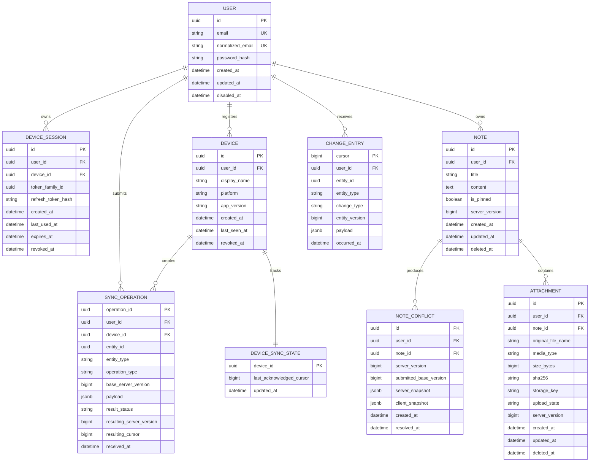

# Fasty — Initial Logical Data Model

## Purpose

This document defines the initial logical entities and invariants required for the personal MVP. It is implementation-oriented but does not replace Entity Framework Core mappings or database migrations.

The model is designed to support:

- multiple devices per user
- offline note editing
- idempotent synchronization
- conflict preservation
- deletion propagation
- attachment metadata and local media eviction
- future account and enterprise expansion

## Conventions

- External entity identifiers use UUIDs.
- Server timestamps are stored in UTC.
- Device timestamps may be retained for display or diagnostics but never establish authoritative synchronization order.
- Each mutable synchronized entity has a server-managed version.
- Server changes are ordered by a monotonic change cursor.
- Soft deletion uses tombstones before physical retention cleanup.
- Database constraints enforce ownership, uniqueness, and referential integrity.

## Core relationships



## Identity module

### User

Represents a Fasty account.

Initial fields:

- `Id`
- `Email`
- `NormalizedEmail`
- framework-managed password and security fields
- `CreatedAt`
- `UpdatedAt`
- `DisabledAt`

Rules:

- Email is unique after normalization.
- A disabled account cannot authenticate or synchronize.
- Account identifiers exposed through APIs are UUIDs.

### Device

Represents one logical installation or browser profile.

Rules:

- A device belongs to exactly one user.
- A revoked device cannot synchronize or establish new sessions.
- Device names are user-facing metadata, not security evidence.

### DeviceSession

Represents an authenticated session and refresh-token family.

Rules:

- Refresh tokens are stored only as hashes.
- Rotation updates the current hash transactionally.
- Reuse of an invalidated token revokes the family.
- Sessions may be revoked independently.

## Notes module

### Note

Initial synchronized note fields:

- `Id`
- `UserId`
- `Title`
- `Content`
- `IsPinned`
- `ServerVersion`
- `CreatedAt`
- `UpdatedAt`
- `DeletedAt`

Rules:

- Notes are private to their owner in the personal MVP.
- `ServerVersion` increases for every accepted mutation.
- A deleted note remains represented as a tombstone until retention cleanup.
- Title and content length limits will be explicit API and database constraints.
- Client timestamps do not override server ordering.

Folders, tags, checklists, rich-text blocks, and sharing are postponed. Their later introduction must not overload the initial `Note` record with unstructured data prematurely.

### NoteConflict

Stores both sides of a rejected stale mutation.

Rules:

- Conflict creation never overwrites the current accepted note.
- The submitted client snapshot and current server snapshot are preserved.
- Resolution creates a normal versioned note mutation.
- Conflict records are visible only to their owner.

## Synchronization module

### SyncOperation

Provides idempotency for client mutations.

The combination of user identity and `OperationId` must be unique. A duplicate request returns the previously committed result instead of applying the mutation again.

Fields include:

- operation and device identity
- entity identity and type
- operation type
- submitted base version
- normalized payload or payload hash
- processing result
- resulting entity version and change cursor
- receipt timestamp

Rules:

- The note mutation, `SyncOperation`, and `ChangeEntry` commit atomically.
- A repeated `OperationId` with a different payload is rejected as invalid.
- Operation records are retained long enough to cover realistic offline retries.

### ChangeEntry

Represents the durable per-user change feed.

Rules:

- `Cursor` is server-generated and strictly increasing.
- Each accepted create, update, or delete produces a change entry.
- Pull queries filter by authenticated owner and `Cursor > after`.
- Payloads contain the synchronized representation required by the client, not internal EF entities.
- Cursor retention and bootstrap behavior must be documented before cleanup is enabled.

### DeviceSyncState

Tracks operational acknowledgement and diagnostics per device.

The client remains responsible for its locally committed cursor. The server-side acknowledged cursor can support retention analysis and device status, but it must not be trusted as proof that local application succeeded unless the protocol explicitly acknowledges it.

## Attachments module

### Attachment

Stores metadata for a binary object stored outside PostgreSQL.

Rules:

- An attachment belongs to one note and one owner.
- The storage key is generated by the server and never trusted from a client-supplied path.
- `Sha256` and `SizeBytes` verify completed uploads.
- Only attachments in `Available` state may be considered durably synchronized.
- Deletion creates a metadata tombstone before physical object cleanup.
- Physical cleanup must be retryable and auditable.

Initial states:

```text
Pending
Uploading
Verifying
Available
Failed
Deleting
Deleted
```

## Local client model

The client SQLite database mirrors synchronized note and attachment metadata but also contains device-only operational tables:

- `LocalNote`
- `LocalAttachment`
- `OutboxOperation`
- `SyncMetadata`
- `LocalConflict`
- optional attachment cache index

### OutboxOperation

Minimum fields:

- `OperationId`
- `EntityId`
- `OperationType`
- `BaseServerVersion`
- serialized payload
- attempt count
- next attempt time
- state
- creation time
- last error category

A local mutation and its outbox operation must commit in one SQLite transaction.

### SyncMetadata

Stores at least:

- last fully applied server cursor
- bootstrap state
- last successful synchronization time
- current schema/protocol compatibility metadata

Applying remote changes and advancing the cursor must occur in one SQLite transaction.

## Critical database constraints

The implementation must include equivalent constraints for:

- normalized user email uniqueness
- device ownership
- operation-ID uniqueness per user
- note ownership foreign keys
- attachment ownership and note relationship
- nonnegative attachment size
- valid state values
- server version greater than zero for synchronized entities
- unique or indexed change cursor
- efficient pull index on `(UserId, Cursor)`
- efficient active-note index on `(UserId, DeletedAt, UpdatedAt)`

## Transaction boundaries

### Accepted note mutation

One PostgreSQL transaction writes:

1. note create/update/tombstone
2. idempotency operation result
3. durable change-feed entry
4. optional conflict resolution state

### Attachment completion

The binary upload itself cannot share a database transaction. Completion therefore uses a state machine:

1. upload binary to temporary object key
2. verify size and hash
3. promote or mark object durable
4. commit attachment metadata as `Available`
5. publish change entry
6. return acknowledgement

Cleanup jobs remove abandoned temporary objects safely.

## Deferred entities

The following are intentionally excluded from the first data model:

- organizations and workspaces
- note sharing and permissions
- tags and folders
- rich-text blocks
- comments and collaboration
- reminders
- audit-log product features
- AI embeddings
- billing and subscriptions

They require separate requirements and migrations when introduced.
